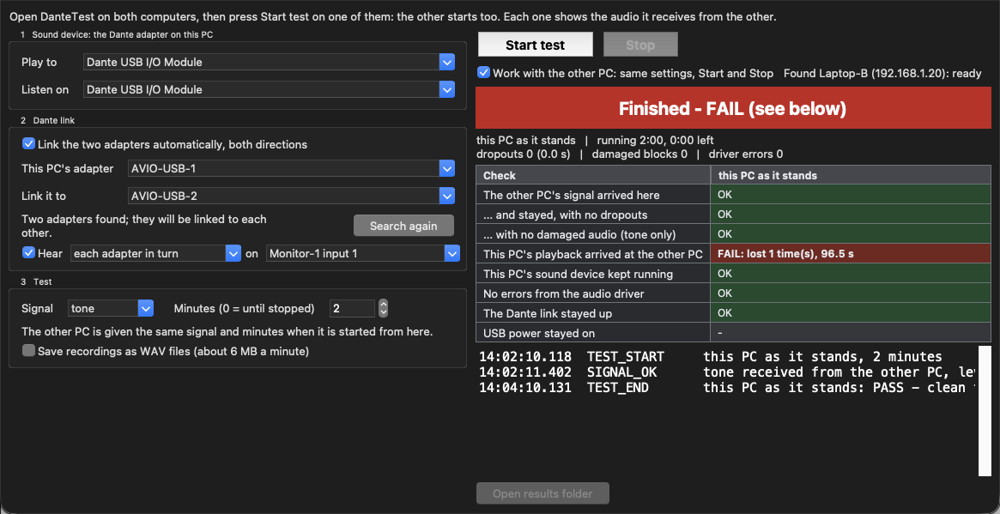

# DanteTest

A two-computer audio test for Dante USB adapters, for Windows 10/11 and macOS.

Each computer plays a continuous test signal into its Dante adapter and listens for the other
computer's signal coming back. Both directions are tested at the same time, and every fault is
written to a timestamped log. By default the test runs music, then voice, then a 1 kHz tone,
one after the other, because some laptops pass one kind of sound and remove another.

It was written to track down audio dropouts with Dante USB adapters on an AMD laptop, and it
checks the things that turned out to matter there:

- dropouts and damaged audio in either direction
- audio processing the laptop maker has attached to the sound device (noise removal, "AI" voice
  effects, Waves, Dolby, DTS and so on), which can remove or alter professional audio
- Windows "audio enhancements", which it can show and switch off for every sound device
- USB power saving on the adapter and its hubs
- on AMD laptops, the AMD USB Audio (offload) Device: a full test runs with it enabled and disabled

The app checks whether the PC has an Intel or AMD processor and shows it beside the buttons. On an
Intel PC (and any PC without the AMD USB Audio Device) it runs the basic test only: play and listen
with music, voice and tone. The full test is only offered where there is an AMD device to switch.

DanteTest is not made or endorsed by Audinate. Dante is a trademark of Audinate Pty Ltd.

## What you need

- Two PCs, each with a Dante USB adapter plugged in (Windows 10/11 64-bit, or a Mac).
- Both adapters on the same network switch.
- Both PCs on that same network (wired or Wi-Fi), so the program can set up the Dante link.
  If a PC is not on that network, set the routing in Dante Controller and the audio test
  still runs.
- One PC should be a known-good reference (for example an Intel PC). A fault is then
  clearly on the other PC.

Nothing has to be installed on Windows: `DanteTest.exe` is a single file.

## Running it on Windows

1. Build `DanteTest.exe` (see below), copy it to both PCs and double-click it on each.
2. Wait for each window to say it has found the other ("Found <name>: ready", under the Start button).
3. Change the settings on either PC: the signal, minutes, the two adapters and the monitor are copied
   to the other one within a second or two.
4. Press **Start test** on either PC. The other one starts too.
   **Stop** on either PC stops both. For the AMD full test, press **Full test** on the PC under test.

The two programs find each other over the local network (UDP port 47847), so both PCs must
be on the same network. If Windows asks whether to allow DanteTest through the firewall, allow
it. If they do not find each other, untick "Work with the other PC" and
press Start test on each PC yourself, choosing the same signal on both.

Both PCs check the Dante link first, then wait for each other, so the test itself starts on
both at the same moment.

When a test finishes, the window shows a table of what passed and what failed, one column for
each test: whether the other PC's signal arrived and stayed, whether this PC's playback arrived
at the other PC (reported by the other PC's DanteTest), the sound device, the audio driver,
the Dante link, USB power, and a warning if audio processing is attached to the Dante device.
The same table is written to `summary.txt`.

The window shows the audio devices it will use, the Dante adapters it found, and the
state of the test in a coloured bar: green while the other PC's signal is arriving, red
during a dropout. Under the bar is a picture of the two computers with an arrow each way
(blue: this PC is playing; green or red: whether the other PC's signal is arriving), and a
graph of the level received over the last two or three minutes.

**Start test** plays and listens until you press **Stop**, or for the number of minutes set.

**Full test** needs administrator rights and restarts the PC twice:

1. Tests for 5 minutes with the AMD USB Audio Device as it is now.
2. Switches the device (enabled to disabled, or the other way), and restarts.
3. After you log in, tests for 5 minutes again by itself.
4. Puts the device back as it was and restarts once more.

The reference PC logs a dropout each time the PC under test restarts. That is expected.

Settings in the window:

| Setting | Use |
|---|---|
| Signal | "music, voice, tone" runs the three one after the other, for the minutes set each (with 0 minutes: a minute each, round and round, until stopped). Or choose one of them. The voice is each PC's built-in voice. Only the tone is checked for clicks and damaged samples; music and voice are checked for dropouts of 0.4 s or longer. Both PCs move from one signal to the next together |
| Bypass Windows audio effects (exclusive mode) | Opens the device in exclusive mode, which skips Windows' mixer and every effect attached to the device |
| Hear ... on ... (step 2) | Tick it to listen to the test on a Dante monitor speaker or mixer on the same network. Choose the input of the monitor to use, and what to hear: one adapter, or **each adapter in turn**, which moves the monitor from one adapter to the other about every 20 seconds so you hear the audio sent and the audio received. Only inputs that nothing else is patched to are offered. When the test ends the input is put back as it was found. The PC where Start was pressed drives the monitor |
| Windows audio enhancements (step 4 in the window) | Lists every sound device on the PC, ticked where Windows' "audio enhancements" are enabled, with the chosen Dante devices first in bold. Click a device to switch it off or on, or press **Switch all off**. Windows asks for administrator rights and keeps the setting after a restart. A device moved to a different USB port can appear as a new entry with enhancements enabled again |
| Save recordings | Saves the signal this PC plays and everything it receives as WAV files in the results folder, about 6 MB a minute |
| Check USB power saving | Reports the power settings of the adapter and its hubs, and watches the power state during the test |

## What it does when it starts

1. Saves the PC model, BIOS, Windows build and audio driver versions to `sysinfo.txt`.
2. Finds the Dante adapters on the network. If there are exactly two, it links each one
   to the other (channels 1 and 2, both ways). With more than two it asks which pair.
3. Plays the tone and starts listening.

## Results

Each run makes a folder under `DanteTest-results`, next to the program, named after the PC and the start time:

| File | Contents |
|---|---|
| `summary.txt` | PASS or FAIL for each test, with dropout counts and times |
| `events.log` | Every event with a timestamp to the millisecond |
| `sysinfo.txt` | PC, BIOS, OS, and the AMD, Dante and USB audio devices and drivers |
| `state.json` | The same results in machine-readable form |

Each PC measures the audio it **receives**. Audio **played** by a PC is measured in the
other PC's log, so send back the results folder from both PCs.

Events in `events.log`:

| Event | Meaning |
|---|---|
| `SIGNAL_OK` | The other PC's tone arrived |
| `DROPOUT_START` / `DROPOUT_END` | The tone was lost, and for how long. "Digital silence" means every sample was exactly zero |
| `GLITCH` | The tone was present but damaged (clicks, repeated or missing samples) |
| `AUDIO_DRIVER` | The audio driver reported a buffer overrun or underrun on this PC |
| `AUDIO_STALLED` / `AUDIO_RESUMED` | The audio input stopped delivering samples and was reopened |
| `DANTE_LINK` / `DANTE_CHANGE` | State of the Dante subscriptions, and any change during the test |
| `NO_SIGNAL` | No tone after 30 seconds |
| `USB_POWER` | Power-saving settings for the adapter and each USB hub above it, the power plan's USB selective suspend setting, mains or battery, and any change of power state during the test (D0 = fully on) |
| `AUDIO_FX` | Audio processing Windows has attached to the Dante device (Realtek, Waves MaxxAudio, DTS and so on), and whether Windows' audio enhancements are switched off |

## Options

The same settings are available from a command prompt. `--headless` runs without the window.

| Option | Use |
|---|---|
| `--minutes N` | Stop after N minutes (default: until stopped; 5 per test with `--matrix`) |
| `--matrix` | Run the full test |
| `--signal all\|music\|voice\|tone` | Test signal (default `all`: music, then voice, then tone); use the same on both PCs |
| `--device TEXT` | Text that identifies the adapter's audio device (default `Dante`) |
| `--adapters A,B` | Names of the two Dante adapters to link |
| `--no-link` | Leave the Dante routing alone |
| `--record` | Save the signal played (`played-*.wav`, one loop) and all the audio received (`received-*.wav`) in the results folder |
| `--enhancements show` (or `off`, `on`) | Windows: show, or switch off or on, audio enhancements for the Dante device and exit. Add `--device .` for every sound device. `off` and `on` need an administrator command prompt |
| `--monitor "DEVICE input N=ADAPTER"` | Also patch that adapter's channel 1 to input N of another Dante device for the test, so it can be heard |
| `--usb-power` | Windows: report USB power-saving settings for the adapter and its hubs, and watch the power state during the test (ticked by default in the window) |
| `--exclusive` | Windows: bypass Windows' mixer and audio effects (exclusive mode) |
| `--headless` | Run without the window |

## Audio effects and enhancement software

Laptop makers attach audio processing to sound devices: Realtek effects, Waves MaxxAudio,
DTS, AI noise removal. It can mute or alter a steady test tone. DanteTest lists whatever
is attached to the Dante device in the log and the summary, and warns when any of it is
not Microsoft's.

To find out whether that processing is involved in a fault, run the test twice: once
normally, and once with **Bypass Windows audio effects (exclusive mode)** ticked. If the
fault disappears with the bypass on, the processing in Windows is the cause, not the
adapter, the USB driver or the network.

## Mac

Open `DanteTest.dmg` and drag DanteTest to Applications. It opens the same window as on
Windows, without the Windows-only parts (audio enhancements, bypass, USB power, the AMD
full test). Results go to `DanteTest-results` in your home folder.

- The app is not signed with an Apple Developer ID. The first time, macOS refuses to open it:
  go to System Settings, Privacy & Security, and press **Open Anyway**.
- macOS asks to let DanteTest use the microphone and find devices on the local network. Allow both.
- The DMG built on an Apple silicon Mac runs on Apple silicon Macs only.

To build the DMG: `scripts/build-mac.sh` (needs `brew install python-tk@3.14` and the
project's `.venv` with netaudio, sounddevice and numpy). For development, `DanteTest.command`
runs the program straight from the source.

## Building DanteTest.exe

Copy `scripts/build-exe.cmd` and `src/dantetest.py` into one folder on a Windows PC with
internet access and double-click `build-exe.cmd`. It installs Python 3.12 if it is missing,
puts PyInstaller and the libraries in `%LOCALAPPDATA%\DanteTest-build`, and leaves
`DanteTest.exe` next to the script.

## Development

`tests/test_detector.py` checks the dropout detector. `tests/gui_smoke.py` drives the
window with a simulated test.

Dante routing uses [netaudio](https://github.com/chris-ritsen/network-audio-controller),
an unofficial open-source Dante controller.
